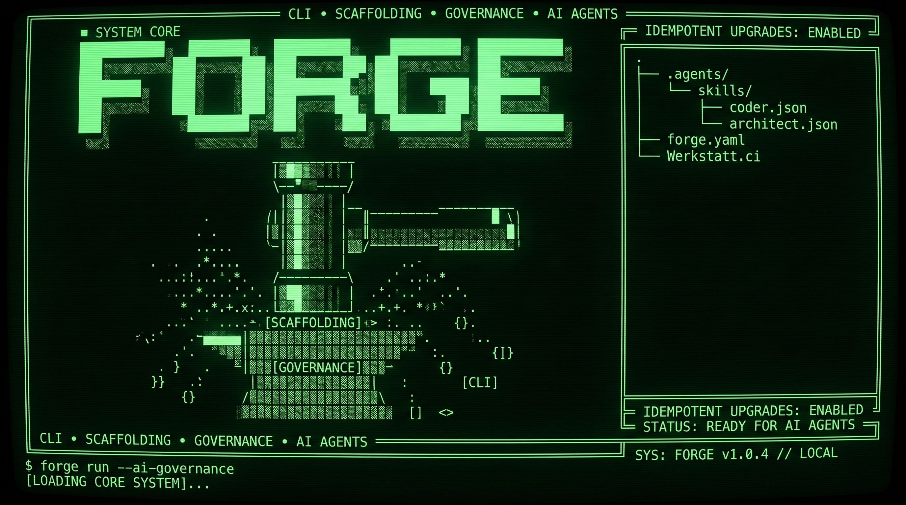

# @warpgogol/forge

[Українська](README.uk.md) | English

**AI can write the code. Forge keeps the project engineered.**

A repository-native control layer for AI-assisted development. Decisions, rules, skills and verification stay with the project — independent of the agent that works on it.

**Battle-tested at scale — not a demo.** Forge already governs a ~5.9M-line engineering fleet: 8 repositories, 40,000+ tracked files, from the monorepo that builds Forge itself to production data platforms. [The measured fleet ↓](#forged-in-production)

> Engineered at [Warpgogol](https://warpgogol.com) · Released as open source. <!-- pkg-health-12: domain name, not a command -->

[](https://www.npmjs.com/package/@warpgogol/forge) [](https://www.npmjs.com/package/@warpgogol/forge) [](https://github.com/syrokomskyi/forge/actions) [](https://nodejs.org) [](LICENSE) <!-- pkg-health-12: domain name, not a command -->



---

## Start right now

Create a new folder, open it in your AI IDE (Windsurf, Cursor, Claude Code, Codex CLI, or any IDE that supports AI agents), and paste this:

```
Install https://npmjs.com/package/@warpgogol/forge in this folder and set up my project. I want to build: [describe your project]
```

Replace `[describe your project]` with your idea — a game, a library, a knowledge base, anything. The AI agent installs Forge, scaffolds the project, and sets up a live preview. From there on, you just talk: describe what you want, and the agent builds it. No programming, no terminal, no commands.

### After the prompt completes — the Bootstrap skill

Once the AI agent has installed Forge and scaffolded your project, it will run the `/forge-bootstrap` skill. This is a required step that configures your project interactively:

- The language the AI uses to communicate with you
- The language for project documentation (RFCs, ADRs, READMEs) — defaults to English
- Your preferred working style — business or creative
- Your name and how you want to be addressed
- Your stack configuration (or migration of an existing project)

The skill asks a few simple questions in the chat, then sets everything up. After it completes, you're ready to create — just tell the AI agent what you want to build.

---

## Quick start (terminal)

```sh
pnpm dlx @warpgogol/forge@latest create --in-place --profile typescript
```

Then open the project in your AI IDE (Windsurf, Cursor, Claude Code, Codex CLI, or any IDE that supports AI agents) and tell the agent what you want to build.

One bootstrap command. After that, work through your coding agent.

### Stack profiles

Forge is project-agnostic. Stack profiles provide ready-made starting points.

| Profile         | Use case                                              |
| --------------- | ----------------------------------------------------- |
| `forge-shell`   | Governance-only projects, libraries, non-web projects |
| `typescript`    | TypeScript monorepo with best-practice validators     |
| `phaser-game`   | Browser games, interactive experiences                |
| `godot-game`    | Desktop/mobile games with Godot 4.x + C#              |
| `knowledge`     | Evidence-backed knowledge bases                       |
| `site-workshop` | Per-client Werkstatt workshops                        |

```sh
# List available profiles
pnpm exec forge profile.validate
```

---

## Architecture

```
IDE / AGENT / MODEL
       ↓
┌──────────────────────────────────┐
│             FORGE                 │
│                                   │
│ Project contract      forge.yaml  │
│ Decisions             RFC / ADR   │
│ Agent workflows       Skills      │
│ Verification          Validators  │
│ Evolution             Upgrade     │
└──────────────────────────────────┘
       ↓
YOUR REPOSITORY
```

Agents can change. Models can change. IDEs can change. Engineering rules stay with the project.

---

## What Forge controls

| Plane              | What it governs                                    |
| ------------------ | -------------------------------------------------- |
| **Intent**         | RFCs, architectural DNA, acceptance criteria       |
| **Decisions**      | ADRs, decision logs, traceability                  |
| **Agent behavior** | Repository-local skills and workflows              |
| **Verification**   | Doctor, validators, contracts, deterministic gates |
| **Evolution**      | Profiles, vendored specs, additive upgrades        |

---

## Without Forge / With Forge

| AI development without Forge          | With Forge                                       |
| ------------------------------------- | ------------------------------------------------ |
| Rules live in prompts                 | Rules live in the repository                     |
| Architecture is implicit              | Decisions become RFCs and ADRs                   |
| Agent behavior depends on the session | Project-local skills define repeatable workflows |
| "Done" means the agent says so        | Validators provide deterministic checks          |
| New agent starts from zero            | Project contract travels with the code           |
| Upgrades risk overwriting decisions   | Upgrade is additive and idempotent               |
| Tool-specific conventions             | Agent- and IDE-independent project layer         |

---

## Forge IS / Forge IS NOT

**Forge IS**

- A repository-native governance layer
- Agent-independent project infrastructure
- A deterministic complement to probabilistic AI agents
- A portable project contract

**Forge IS NOT**

- Another AI model
- Another coding agent
- An IDE
- A hosted platform
- A replacement for Git
- A magic "vibe coding" wrapper

---

## What you get

- **38 skills** — idea-to-RFC pipeline, grilling, preferences, skill authoring
- **RFC workflow** — create, validate, list, graph, archive, acceptance probes
- **ADR workflow** — lightweight architectural decision records
- **Spec vendoring** — vendor external specs as immutable snapshots
- **Naming conventions** — kebab-case linting
- **Workflow linting** — validate `.agents/workflows/` frontmatter
- **Stack scaffolding** — pnpm + Turborepo monorepo from a profile
- **Bindings contract** — de-hardcode project-specific commands via `forge.yaml`
- **Session audit** — deterministic detectors over saved agent sessions: circumvention, blocker deception, false completion claims
- **Trajectory memory** — extract proven procedures from verified sessions and recall them at decision points
- **Context assembly** — budgeted, ranked context slates for a task description
- **Gate probes** — prove governance gates still fire on seeded violations
- **YAML scalar lint** — catch unquoted colon-space traps before they corrupt frontmatter
- **Golden conformance** — run producer→consumer contract conformance across declared surfaces
- **Agent operating model** — EXPLORE/ROUTINE/GOVERNED work modes with explicit authority boundaries (the operator owns intent and significant decisions; the agent owns implementation inside them, and escalates rather than guesses when a boundary is crossed), a proportionate verification portfolio with tiers (tests are one tool — rigor scales to risk, not a mandatory-TDD rule; skills declare `notApplicableWhen`/`costNotes` so a mismatching skill is not force-applied), and separated completion vocabulary (IMPLEMENTED / VERIFIED / ACCEPTED / RELEASED), shipped as a shared skill and synced by `forge upgrade`
- **Doctor** — project health check
- **Upgrade** — additive, idempotent skill and config sync

---

## Working with your AI agent

Forge works with any AI agent — Windsurf, Cursor, Claude Code, Codex CLI, or any IDE that supports agent skills. The setup is the same; only the conversation matters.

**Start with questions, not commands.** Before asking the agent to write code, ask it about the codebase. The agent can read files, search git history, and run Forge CLI commands — let it explore first.

**Describe results, not steps.** Tell the agent what you want, not how to do it. For complex work, ask the agent to plan first and wait for your approval.

**Let the agent verify its own work.** Give criteria for "done" and let the agent check itself: "Run the tests after you're done." "Validate the RFC before committing." "Check project health with `forge doctor`." Forge's operating model teaches agents to report IMPLEMENTED vs VERIFIED vs ACCEPTED separately — a claim never outruns its evidence.

**AGENTS.md is your project's persistent memory.** Forge generates `AGENTS.md` files that the agent reads at the start of every session. Put build commands, code style, architecture decisions, and "do X, not Y" rules there.

---

## CLI

```sh
# Check project health
pnpm exec forge doctor

# Validate RFCs
pnpm exec forge rfc.validate

# List available skills
pnpm exec forge skill.list

# Sync skills and config from installed version
pnpm exec forge upgrade

# Validate public surface consistency
pnpm exec forge public-surface.validate
```

Full CLI reference: [docs/reference/cli.md](docs/reference/cli.md)

---

## forge.yaml

The single source of truth for project configuration:

```yaml
schema: forge/config@1
project:
  name: my-project
  stack: [typescript]
  packageManager: pnpm
paths:
  rfcsDir: docs/rfcs
  adrsDir: docs/adrs
  skillsDir: .agents/skills
bindings:
  schema: forge/bindings@1
  commands:
    validateRfc: "forge rfc.validate {id} --json"
    typecheck: "pnpm run build:check"
    test: "pnpm test"
  paths:
    invariantsFile: docs/architecture-dna.md
  terminology:
    invariants: DNA
```

Full reference: [docs/reference/forge-yaml.md](docs/reference/forge-yaml.md)

---

## Programmatic API

```ts
import {
  forgeCoreModule,
  forgeRfcModule,
  loadForgeConfig,
  resolveBinding,
  FORGE_SKILLS,
} from "@warpgogol/forge";

const config = loadForgeConfig(process.cwd());
const cmd = resolveBinding(config, "commands.validateRfc", { id: "RFC-0001" });

const registry = /* your ForgeModuleRegistry */;
await forgeCoreModule.register(registry);
await forgeRfcModule.register(registry);
```

Full API reference: [docs/reference/programmatic-api.md](docs/reference/programmatic-api.md)

---

## Architecture

| Directory | Purpose |
| --- | --- |
| `src/` | Portable core — types, config, skills registry, validators, onboarding. Zero `@warpgogol/*` imports. |
| `os/` | ForgeModule registrations. All `os/` modules are autonomous except `werkstatt` — the only adapter importing `@warpgogol/werkstatt-engine`. |
| `bin/` | CLI entrypoint (`forge` command). |
| `skills/` | 38 skill definitions (30 fo + 5 shared + 3 meta) with SKILL.md frontmatter. |
| `profiles/` | Stack profiles for `scaffold`. |

---

## Upgrade flow

```sh
pnpm update @warpgogol/forge
pnpm exec forge upgrade
pnpm exec forge doctor
```

`forge upgrade` is additive — it never overwrites operator-set bindings, is idempotent, and reconciles the generated surface on every run (including same-version noop): synced skill dirs get a `.forge-managed` manifest, stale marked dirs are pruned only when their contents match the manifest, and prettier consumers get a delimited forge-managed block in `.prettierignore` (RFC-1154). Use `--dry-run` to preview changes. Editable generated guides (`AGENTS.md`) are merged, not overwritten: content below the `<!-- forge:custom -->` boundary is preserved verbatim on regeneration (RFC-1153), and `--dry-run` reports `nestedAgentsPlanned` / `nestedAgentsPreserved` / `nestedAgentsSkipped`.

---

## Documentation

- [Getting started](docs/getting-started.md)
- [Why Forge?](docs/concepts/why-forge.md)
- [Project contract](docs/concepts/project-contract.md)
- [Governance model](docs/concepts/governance-model.md)
- [Bring an existing project](docs/guides/existing-project.md)
- [Upgrading](docs/guides/upgrading.md)
- [Skills](docs/guides/skills.md)
- [RFC and ADR workflows](docs/guides/rfc-adr.md)
- [CLI reference](docs/reference/cli.md)
- [forge.yaml reference](docs/reference/forge-yaml.md)
- [Profiles](docs/reference/profiles.md)
- [Programmatic API](docs/reference/programmatic-api.md)
- [Publishing](docs/maintainers/publishing.md)

---

## Forged in production

Forge does not govern toy projects. It is the control layer of a working engineering fleet — measured 2026-11-13 by Forge's own `codebase.measure` over git-tracked files only (generated, vendored, and mirrored content is classified separately; export mirrors and deployment caches are excluded to avoid double counting).

| Repository | Role | Files | Code lines | code | tests | docs | generated | Top language |
| --- | --- | --- | --- | --- | --- | --- | --- | --- |
| pipelines | Production document pipeline suite | 22,609 | 3,122,894 | 1,215,172 | 127,237 | 1,747,517 | 32,968 | Markdown |
| werkstatt | The platform monorepo that builds Forge itself | 14,084 | 1,737,825 | 808,969 | 351,999 | 233,302 | 343,555 | TypeScript |
| dater | Production product monorepo | 1,419 | 479,041 | 380,487 | 51,992 | 31,716 | 14,846 | JSON |
| hdri | Client repository | 1,510 | 463,226 | 402,796 | 38,774 | 13,763 | 7,893 | TypeScript |
| lagebild | Client-facing data platform | 486 | 50,096 | 16,660 | 13,319 | 10,774 | 9,343 | TypeScript |
| metads | Product monorepo | 283 | 48,011 | 34,096 | 3,310 | 1,456 | 9,149 | TypeScript |
| dialogue-steward | Product monorepo | 288 | 34,698 | 13,935 | 5,666 | 4,665 | 10,432 | TypeScript |
| warpgogol-verbund | System hub — product registry and task queue | 132 | 9,671 | 7,160 | 0 | 1,467 | 1,044 | Other |
| **Fleet total** |  | 40,811 | 5,945,462 | 2,879,275 | 592,297 | 2,044,660 | 429,230 |  |

Language rollup across the fleet: Markdown 34.1%, TypeScript 25.3%, JSON 19.1%, YAML 15.3%, XML 3.2% — a fleet where a third of the mass is written knowledge, which is exactly what a governance layer exists to keep coherent.

Symbol counts come from a real TypeScript AST pass — 98,494 symbols measured (1,721 classes, 90,761 functions, 6,012 methods), not regex estimates. Where a workspace resolves a compiler the walker cannot use, the command reports `symbolsSkipped` instead of fabricating numbers.

Measure your own repository:

```sh
pnpm exec forge codebase.measure --json
```

---

## License

Apache-2.0

## Open Engineering

This package originated from production engineering work at [Warpgogol](https://warpgogol.com), an engineering studio in Germany.

We publish reusable parts of our infrastructure when they can be useful beyond our own projects. It is published independently of any Warpgogol commercial service. Using this package does not create any dependency on Warpgogol.

Built for real systems. Shared openly.
