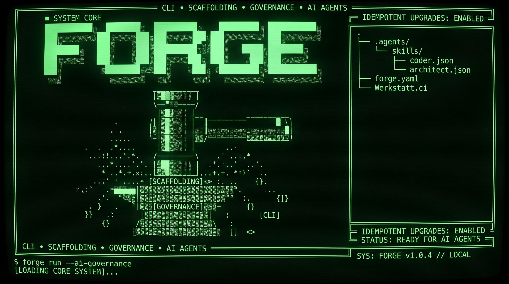

# @warpgogol/forge

Українська | [English](README.md)

**ШІ-агенти пишуть код. Forge тримає проєкт інженерним.**

Шар інженерного керування, вбудований у репозиторій, для розробки за допомогою ШІ. Рішення, правила, навички та перевірки залишаються з репозиторієм — незалежно від агента, моделі чи IDE, що виконує роботу.

**Спочатку перевірено на собі.** Монорепозиторій, що будує Forge, управляється Forge: 1 500+ RFC, 130+ ADR і 41 навичка агентів, кожна зміна, злита в main, проходить детерміновані гейти верифікації — а не «агент так каже». Той самий шар уже управляє сукупністю інженерних репозиторіїв — ~5,9 млн рядків у 8 репозиторіях. [Виміряні репозиторії ↓](#перевірено-на-реальних-проєктах)

> Розроблено в [Warpgogol](https://warpgogol.com) · Опубліковано як open source.

[](https://www.npmjs.com/package/@warpgogol/forge) [](https://www.npmjs.com/package/@warpgogol/forge) [](https://github.com/syrokomskyi/forge/actions) [](https://nodejs.org) [](LICENSE)



---

## Проблема

ШІ-агенти зробили написання коду дешевим — а збереження цілісності та узгодженості проєкту дорогим.

- Правила живуть у промптах, що зникають між сесіями.
- Архітектурні рішення лишаються неявними — кодова база не може пояснити, _чому_ вона виглядає так.
- «Готово» означає, що агент так каже.
- Зміна агента, моделі чи IDE обнуляє пам'ять проєкту.

Кожен додатковий агент підвищує ризик розходження з правилами проєкту. Швидкість без контролю — це технічний борг, що накопичується зі швидкістю роботи ШІ-агентів.

## Шар, якого бракує

Агенти й моделі — взаємозамінні частини. Проєкту потрібен контрольний шар, який ні.

```
IDE / АГЕНТ / МОДЕЛЬ
       ↓
┌──────────────────────────────────┐
│             FORGE                 │
│                                   │
│ Контракт проєкту      forge.yaml  │
│ Рішення                RFC / ADR   │
│ Поведінка агента      Skills      │
│ Перевірка             Validators  │
│ Еволюція              Upgrade     │
└──────────────────────────────────┘
       ↓
ВАШ РЕПОЗИТОРІЙ
```

Агенти можуть змінюватися. Моделі можуть змінюватися. IDE можуть змінюватися. Інженерні правила залишаються з проєктом.

## Один контракт проєкту. Кілька агентів.

Forge зберігає інженерні правила у переносних файлах репозиторію — `forge.yaml`, `AGENTS.md`, RFC, навички. Сумісні агенти можуть споживати ті самі інструкції, рішення та робочі процеси: **Devin**, Windsurf, Cursor, Claude Code, Codex CLI — і будь-який наступний. Детерміновані перевірки залишаються незалежними від агента і можуть бути примусовими через CI. Жодних плагінів під вендора, жодного lock-in.

Це робить автономну розробку простішою для інспекції та верифікації: детерміновані гейти перевіряють задекларовані інваріанти, а аудит сесій виявляє потенційні порушення правил і видає результати, придатні для ревью. Специфіка Devin CLI / Devin Cloud — порядок встановлення, прохід однієї задачі та чесні межі — у [docs/integrations/devin.md](docs/integrations/devin.md).

---

## Почни зараз

Створіть нову папку, відкрийте її у вашому ШІ-IDE або передайте вашому кодовому агентові, і вставте це:

```
Install https://npmjs.com/package/@warpgogol/forge in this folder and set up my project. I want to build: [describe your project]
```

Замініть `[describe your project]` своєю ідеєю — гра, бібліотека, база знань, будь-що. ШІ-агент встановить Forge, створить структуру проєкту і — для профілів із запускаємою поверхнею — налаштує попередній перегляд працюючого застосунку. Далі ви просто говорите: описуєте, що хочете, і агент будує. Без програмування, без терміналу, без команд.

Цей робочий процес потребує агента з доступом до файлової системи та виконання команд, сумісного середовища (Node.js 24.x, pnpm) і дозволу на встановлення залежностей.

### Після завершення промпту — Bootstrap skill

Коли ШІ-агент встановить Forge і створить структуру проєкту, він запустить навичку `/forge-bootstrap`. Це обов'язковий крок, який інтерактивно налаштовує ваш проєкт:

- Мову, якою ШІ спілкується з вами
- Мову документації проєкту (RFC, ADR, README) — за замовчуванням англійська
- Ваш стиль роботи — діловий або творчий
- Ваше ім'я та форму звернення
- Вашу конфігурацію стеку (або міграцію існуючого проєкту)

Навичка ставить кілька простих запитань у чаті, потім усе налаштовує. Після завершення ви готові творити — просто скажіть ШІ-агенту, що хочете побудувати.

---

## Швидкий старт (термінал)

```sh
pnpm dlx @warpgogol/forge@latest create --in-place --profile typescript
```

Потім відкрийте проєкт у вашому ШІ-IDE або передайте його вашому кодовому агентові й опишіть, що хочете побудувати. Одна команда — далі робота через агента.

### Профілі стеку

Forge не залежить від типу проєкту. Профілі стеку — готові стартові точки.

| Профіль         | Призначення                                      |
| --------------- | ------------------------------------------------ |
| `forge-shell`   | Лише управління, бібліотеки, не-веб проєкти      |
| `typescript`    | TypeScript монорепозиторій з валідаторами        |
| `phaser-game`   | Браузерні ігри, інтерактивні досвіди             |
| `godot-game`    | Десктопні/мобільні ігри на Godot 4.x + C#        |
| `knowledge`     | Бази знань з підтримкою доказів                  |
| `site-workshop` | Робочі середовища Werkstatt для окремих клієнтів |

```sh
# Перелічити доступні профілі
pnpm exec forge profile.validate
```

---

## Що контролює Forge

| Площина              | Що управляє                                         |
| -------------------- | --------------------------------------------------- |
| **Намір**            | RFC, архітектурна ДНК, критерії приймання           |
| **Рішення**          | ADR, журнали рішень, відстежуваність                |
| **Поведінка агента** | Локальні навички та робочі процеси                  |
| **Перевірка**        | Doctor, валідатори, контракти, детерміновані гейти  |
| **Еволюція**         | Профілі, вендоринг специфікацій, адитивні оновлення |

Інструкції, валідація та примус — різні рівні; що гарантує кожен з них, див. [модель верифікації](docs/concepts/verification-model.md).

---

## Без Forge / З Forge

| Розробка з ШІ без Forge                | З Forge                                          |
| -------------------------------------- | ------------------------------------------------ |
| Правила живуть у промптах              | Правила живуть у репозиторії                     |
| Архітектура неявна                     | Рішення стають RFC та ADR                        |
| Поведінка агента залежить від сесії    | Локальні навички визначають відтворювані процеси |
| «Готово» означає, що агент так каже    | Валідатори дають детерміновані перевірки         |
| Новий агент починає з нуля             | Контракт проєкту зберігається разом із кодом     |
| Оновлення ризикує перезаписати рішення | Оновлення адитивне та ідемпотентне               |
| Конвенції специфічні для інструменту   | Агент- та IDE-незалежний шар проєкту             |

---

## Forge Є / Forge Не Є

**Forge Є**

- Шар інженерного керування, вбудований у репозиторій
- Агент-незалежна інфраструктура проєкту
- Детерміноване доповнення до ймовірнісних ШІ-агентів
- Портативний контракт проєкту

**Forge Не Є**

- Ще однією ШІ-моделлю
- Ще одним агентом-кодером
- IDE
- Хостованою платформою
- Заміною Git
- Магічною обгорткою «vibe coding»

---

## Що ви отримуєте

**Рішення та знання**

- **RFC робочий процес** — створення, валідація, перелік, граф, архівування, acceptance probes
- **ADR робочий процес** — легкі записи архітектурних рішень
- **Вендоринг специфікацій** — вендоринг зовнішніх специфікацій як незмінних снапшотів
- **Пам'ять траєкторій** — вилучення перевірених процедур з верифікованих сесій і їх відкликання у точках прийняття рішень
- **Складання контексту** — бюджетні ранжовані контекстні вибірки за описом задачі

**Поведінка агента**

- **41 навичка** — повний пайплайн ідея → RFC → план → реалізація → рев'ю → виправлення, grilling, preferences, авторинг навичок
- **Операційна модель агента** — режими EXPLORE/ROUTINE/GOVERNED з явними межами повноважень (оператор володіє наміром; агент володіє реалізацією та ескалює, а не здогадується, на межі), пропорційне портфоліо верифікації та розділена термінологія завершення — IMPLEMENTED / VERIFIED / ACCEPTED / RELEASED — постачається як спільна навичка й синхронізується через `forge upgrade`
- **Аудит сесій** — детерміністичні детектори над збереженими сесіями агентів: обходи, приховування блокерів, неправдиві заяви про завершення

**Перевірка та еволюція**

- **Doctor** — перевірка здоров'я проєкту
- **Валідатори** — lint найменувань, lint frontmatter робочих процесів, lint скалярів YAML, консистентність публічної поверхні
- **Проби гейтів** — доведення, що гейти управління досі спрацьовують на засіяних порушеннях
- **Еталонна перевірка відповідності** — прогін відповідності контракту виробник→споживач по задекларованих поверхнях
- **Upgrade** — адитивна, ідемпотентна синхронізація навичок та конфігурації
- **Скаффолдинг стеку** — pnpm + Turborepo монорепозиторій з профілю
- **Контракт прив'язок** — деконкретизація команд проєкту через `forge.yaml`

---

## Робота з вашим ШІ-агентом

Forge працює з будь-яким ШІ-агентом — Devin, Windsurf, Cursor, Claude Code, Codex CLI — бо контракт живе в репозиторії, а не у вендорському плагіні. Налаштування однакове; важлива лише розмова.

**Починайте з питань, а не з команд.** Перед тим, як просити агента писати код, запитайте його про кодову базу. Агент може читати файли, шукати в історії git та запускати CLI-команди Forge — дайте йому спочатку дослідити.

**Описуйте результат, а не кроки.** Скажіть агенту, що ви хочете, а не як це зробити. Для складних задач просіть агента спочатку спланувати.

**Дозвольте агенту перевіряти власну роботу.** Дайте критерії «готово» і дозвольте агенту перевірити себе: «Запусти тести після завершення.» «Валідуй RFC перед комітом.» «Перевір здоров'я проєкту через `forge doctor`.» Операційна модель Forge вчить агентів звітувати IMPLEMENTED, VERIFIED та ACCEPTED окремо — заява ніколи не випереджає докази.

**AGENTS.md — постійна пам'ять вашого проєкту.** Forge генерує файли `AGENTS.md`, які агент читає на початку кожної сесії. Кладіть туди команди збірки, стиль коду, архітектурні рішення та правила «роби X, а не Y».

---

## forge.yaml

Єдине джерело істини для конфігурації проєкту:

```yaml
schema: forge/config@1
project:
  name: my-project
  stack: [typescript]
  packageManager: pnpm
paths:
  rfcsDir: docs/rfcs
  adrsDir: docs/adrs
  skillsDir: .agents/skills
bindings:
  schema: forge/bindings@1
  commands:
    validateRfc: "forge rfc.validate {id} --json"
    typecheck: "pnpm run build:check"
    test: "pnpm test"
  paths:
    invariantsFile: docs/architecture-dna.md
  terminology:
    invariants: DNA
```

Повний довідник: [docs/reference/forge-yaml.md](docs/reference/forge-yaml.md)

---

## CLI

```sh
# Перевірити здоров'я проєкту
pnpm exec forge doctor

# Валідувати RFC
pnpm exec forge rfc.validate

# Перелічити доступні навички
pnpm exec forge skill.list

# Синхронізувати навички та конфігурацію
pnpm exec forge upgrade

# Перевірити консистентність публічної поверхні
pnpm exec forge public-surface.validate
```

Повний довідник CLI: [docs/reference/cli.md](docs/reference/cli.md)

---

## Перевірено на реальних проєктах

Forge управляє не іграшковими проєктами — починаючи з себе. Монорепозиторій werkstatt, що будує Forge, несе **1 563 RFC і 131 ADR** під управлінням Forge, і кожна зміна проходить детермінований інтеграційний гейт. Той самий шар інженерного контролю керує робочою сукупністю інженерних репозиторіїв — виміряно 2026-11-13 власною командою `codebase.measure` лише за git-tracked файлами (згенерований, вендорений і дзеркальний вміст класифікується окремо; експортні дзеркала та деплой-кеші виключено, щоб уникнути подвійного підрахунку).

| Репозиторій | Роль | Файли | Разом | code | tests | docs | generated | Топ-мова |
| --- | --- | --- | --- | --- | --- | --- | --- | --- |
| pipelines | Продакшн-сьют документних пайплайнів | 22 609 | 3 122 894 | 1 215 172 | 127 237 | 1 747 517 | 32 968 | Markdown |
| werkstatt | Платформний монорепозиторій, що будує сам Forge | 14 084 | 1 737 825 | 808 969 | 351 999 | 233 302 | 343 555 | TypeScript |
| dater | Продакшн-продуктовий монорепозиторій | 1 419 | 479 041 | 380 487 | 51 992 | 31 716 | 14 846 | JSON |
| hdri | Клієнтський репозиторій | 1 510 | 463 226 | 402 796 | 38 774 | 13 763 | 7 893 | TypeScript |
| lagebild | Клієнтська платформа даних | 486 | 50 096 | 16 660 | 13 319 | 10 774 | 9 343 | TypeScript |
| metads | Продуктовий монорепозиторій | 283 | 48 011 | 34 096 | 3 310 | 1 456 | 9 149 | TypeScript |
| dialogue-steward | Продуктовий монорепозиторій | 288 | 34 698 | 13 935 | 5 666 | 4 665 | 10 432 | TypeScript |
| warpgogol-verbund | Системний хаб — реєстр продуктів і черга задач | 132 | 9 671 | 7 160 | 0 | 1 467 | 1 044 | Other |
| **Флот разом** |  | 40 811 | 5 945 462 | 2 879 275 | 592 297 | 2 044 660 | 429 230 |  |

`Разом` розкладається точно на `code + tests + docs + generated` — кожен відстежуваний рядок класифіковано, жоден не пораховано двічі.

Зведення мов по репозиторіях: Markdown 34.1%, TypeScript 25.3%, JSON 19.1%, YAML 15.3%, XML 3.2% — сукупність, у якій третина маси — це письмове знання, і саме для цього існує шар управління, що тримає її узгодженою.

Кількість символів походить зі справжнього TypeScript AST-проходу — виміряно 98 494 символи (1 721 клас, 90 761 функція, 6 012 методів), а не оцінки регулярними виразами. Там, де workspace резолвить компілятор, який аналізатор не може використати, команда звітує `symbolsSkipped` замість вигаданих чисел.

Виміряйте власний репозиторій:

```sh
pnpm exec forge codebase.measure --json
```

Методологія, робочий приклад та обмеження: [docs/reference/fleet-measurement.md](docs/reference/fleet-measurement.md). Це самозаявлені числа власного інструменту Forge — показник приладу, а не незалежний аудит.

### Одна задача. Один контракт. Один перевірений результат.

Цей README і є тематичним дослідженням. Версію 9.6.2 — включно з цим файлом — написано наскрізь ШІ-агентом під керівництвом оператора: агент переписав README, власний гейт коміту Forge виконав скоуплені перевірки, інтеграційний гейт запустив важкий набір тестів, а CI виконав lint/typecheck/build/test перед `npm publish --provenance`. Кожен перехід дав артефакт, який можна перевірити — [реліз v9.6.2](https://github.com/syrokomskyi/forge/releases/tag/v9.6.2) · [запуски CI](https://github.com/syrokomskyi/forge/actions) · [слід доказів](docs/evidence/release-9.6.2.md).

---

## Куди рухається Forge

- **Більше профілів стеку** — управляємий скаффолдинг для екосистем поза TypeScript.
- **Глибші докази сесій** — пам'ять траєкторій, аудит сесій і проби гейтів, що ростуть у повний контур довіри для автономних агентів.
- **Більше контрактних поверхонь** — золота відповідність через додаткові межі виробник→споживач.

---

## Програмний інтерфейс (API)

```ts
import {
  createForgeRfcModule,
  type ForgeLogger,
  type ForgeRuntimeContext,
} from "@warpgogol/forge";

const logger: ForgeLogger = {
  section: console.log,
  info: console.log,
  warn: console.warn,
  error: console.error,
  success: console.log,
};
const context: ForgeRuntimeContext = {
  workspaceRoot: process.cwd(),
  logger,
  dryRun: false,
  outputFormat: "json",
};

const rfcModule = await createForgeRfcModule();
const rfcValidate = rfcModule.commands.find((c) => c.name === "rfc.validate");
const result = await rfcValidate?.execute({ argv: [], flags: {} }, context);
console.log(result?.exitCode); // 0 = pass, 1 = fail
```

Повний API: [docs/reference/programmatic-api.md](docs/reference/programmatic-api.md)

---

## Структура

| Директорія | Призначення |
| --- | --- |
| `src/` | Портативне ядро — типи, конфіг, реєстр навичок, валідатори, онбординг. Нуль `@warpgogol/*` імпортів. |
| `os/` | Реєстрації ForgeModule. Усі модулі `os/` автономні, крім `werkstatt` — єдиного адаптера, що імпортує `@warpgogol/werkstatt-engine`. |
| `bin/` | Точка входу CLI (команда `forge`). |
| `skills/` | <!-- forge:skills-count -->41 skills (34 fo + 4 shared + 3 meta)<!-- /forge:skills-count --> з SKILL.md frontmatter. |
| `profiles/` | Профілі стеку для `scaffold`. |

---

## Оновлення

```sh
pnpm update @warpgogol/forge
pnpm exec forge upgrade
pnpm exec forge doctor
```

`forge upgrade` — адитивний: ніколи не перезаписує прив'язки, встановлені оператором, ідемпотентний, і при кожному запуску (включно з noop тієї ж версії) узгоджує згенеровану поверхню: синхронізовані каталоги скілів отримують маніфест `.forge-managed`, застарілі позначені каталоги видаляються лише коли їхній вміст відповідає маніфесту, а споживачі prettier отримують делімітований forge-managed блок у `.prettierignore` (RFC-1154). Використовуйте `--dry-run` для попереднього перегляду. Редаговані згенеровані гайди (`AGENTS.md`) об'єднуються, а не перезаписуються: вміст нижче межі `<!-- forge:custom -->` зберігається без змін при регенерації (RFC-1153), а `--dry-run` звітує `nestedAgentsPlanned` / `nestedAgentsPreserved` / `nestedAgentsSkipped`.

---

## Документація

- [Початок роботи](docs/getting-started.md)
- [Чому Forge?](docs/concepts/why-forge.md)
- [Контракт проєкту](docs/concepts/project-contract.md)
- [Модель управління](docs/concepts/governance-model.md)
- [Модель верифікації](docs/concepts/verification-model.md)
- [Перенесення наявного проєкту](docs/guides/existing-project.md)
- [Оновлення](docs/guides/upgrading.md)
- [Навички](docs/guides/skills.md)
- [RFC та ADR робочі процеси](docs/guides/rfc-adr.md)
- [Сценарії верифікації та доказів](docs/guides/verification-and-evidence.md)
- [Інтеграція Devin](docs/integrations/devin.md)
- [Довідник CLI](docs/reference/cli.md)
- [Довідник forge.yaml](docs/reference/forge-yaml.md)
- [Профілі](docs/reference/profiles.md)
- [Програмний інтерфейс (API)](docs/reference/programmatic-api.md)
- [Методологія вимірювання репозиторіїв](docs/reference/fleet-measurement.md)
- [Публікація](docs/maintainers/publishing.md)

---

## Ліцензія

Apache-2.0

## Відкрита інженерія

Цей пакет походить з виробничої інженерної роботи [Warpgogol](https://warpgogol.com), інженерної студії в Німеччині, що постачає клієнтські продукти через той самий управляємий Forge, агент-керований пайплайн.

Ми публікуємо багаторазово використовувані частини нашої інфраструктури, коли вони можуть бути корисні поза нашими власними проєктами. Пакет публікується незалежно від будь-якого комерційного сервісу Warpgogol. Використання цього пакету не створює залежності від Warpgogol.

Створено для реальних систем. Поділяємо відкрито.
